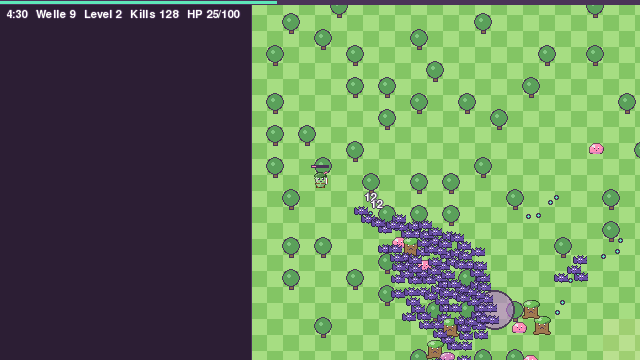

# Last Bean Standing

A small stop-and-shoot roguelite with bean mascots, built in Python with pygame-ce.
Time-based waves in a finite arena with four biomes, bosses, shrines and an endless swarm after 20:00.
Portfolio project: clean code, tests, and later a reinforcement-learning agent that plays the game.



**Status:** working towards 1.0 (docs/ROADMAP.md): big map, items and seed chests, story frame (docs/STORY.md), phones first; earlier: online leaderboard, pixel sprites, particles, hit flashes, damage numbers, screen shake, synthesised sound effects, on top of all phase-1 enemies, elites, boss Ildra, menu and local highscores.

Play in the browser, made for phones and tablets first (touch joystick, portrait or landscape): https://hannes-vnz.github.io/last_bean_standing/  
On iPhone: Share → Add to Home Screen for fullscreen. Pinch with two fingers (or mouse wheel, +/-) to zoom.

## Quick start

```bash
python -m venv .venv && source .venv/bin/activate   # Python 3.11+
pip install -e ".[dev]"
python -m lastbean        # WASD/arrows move (auto-fire), Space ability, 1/2/3 pick upgrades, M mute, L leaderboard, Esc pause
pytest                    # tests
ruff check                # lint
```

## Browser version

```bash
pip install -e ".[web]"
python tools/build_web.py --serve   # http://localhost:8000
```

Every push to `main` builds the web version and publishes it on GitHub Pages (`.github/workflows/pages.yml`).
Debug keys: F3 timings, F4 stress test (200 enemies), F5 benchmark.

## Layout

- `src/lastbean/sim/` – deterministic headless simulation (no pygame), fixed 1/60 s step
- `src/lastbean/data/` – loads and validates `data/*.json`
- `src/lastbean/render/` – draws snapshots on a 640x360 canvas, integer-scaled
- `data/` – game content, generated by `tools/build_content.py`
- `docs/DESIGN.md` – design and milestones (German), `docs/CONTENT.md` – content tables
- `server/` – reference leaderboard server (separate, optional)

## Performance

Measured with `python tools/bench.py --render` (Apple Silicon, Python 3.12, headless drawing):

| Enemies | Simulation | Drawing | Total per frame (budget 16.7 ms) |
|---|---|---|---|
| 200 | 1.4 ms | 1.8 ms | 3.2 ms |
| 350 (cap) | 2.6 ms | 2.2 ms | 4.8 ms |
| 200, browser (pygbag 0.9.3, F5) | 1.7 ms | 2.4 ms | 4.1 ms |

Balancing (`python tools/balance.py --seeds 20`, heuristic bot as ranger): median death 3:26 (2:44 to 6:03) at median level 15; level 2 after about 10 s, level 10 at about 1:40. A real run peaks at about 350 enemies and 2.9 ms simulation per step around 5:30.

## Assets

See [ASSETS.md](ASSETS.md).
